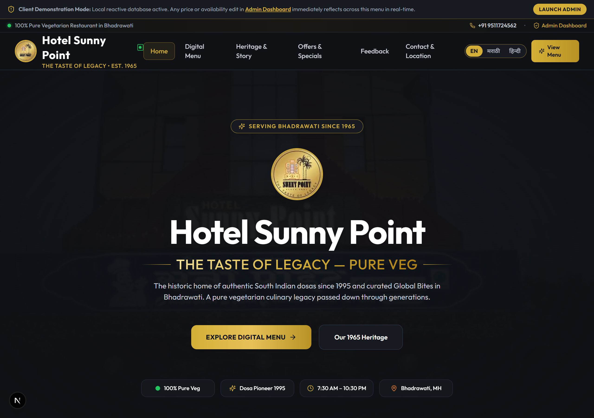
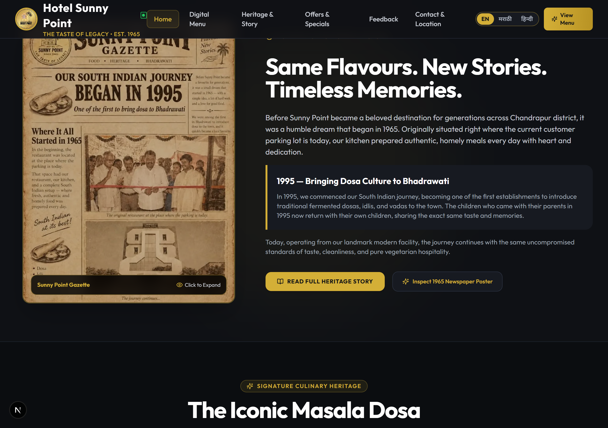
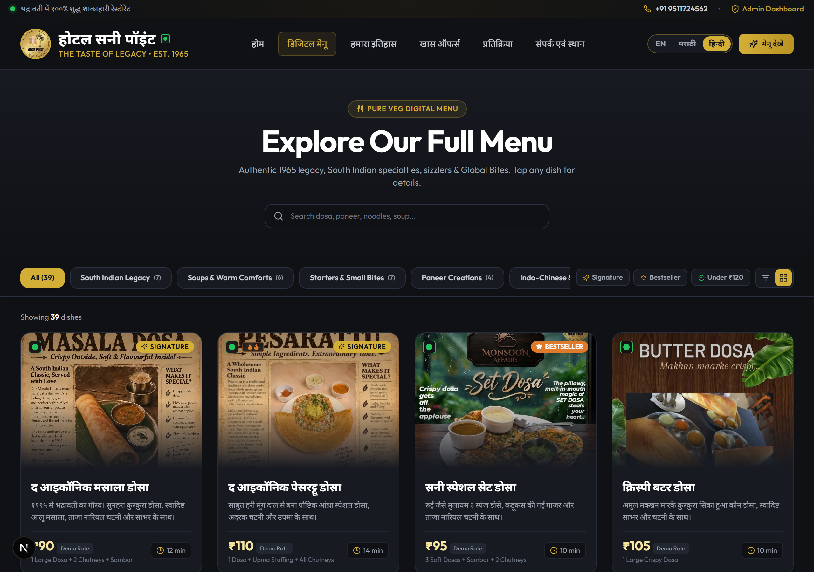
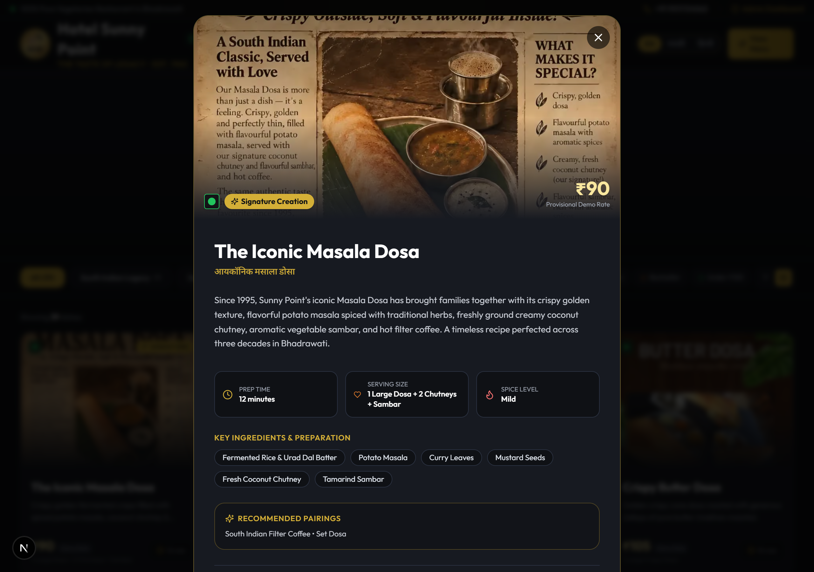
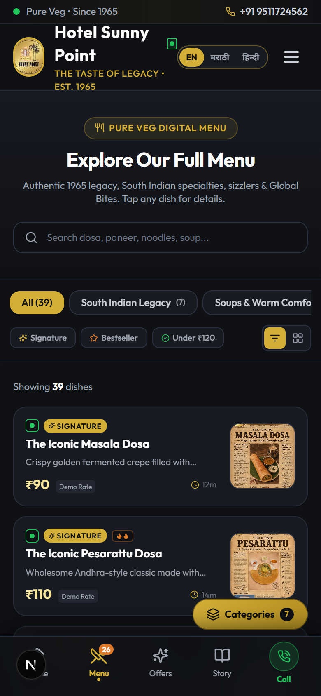
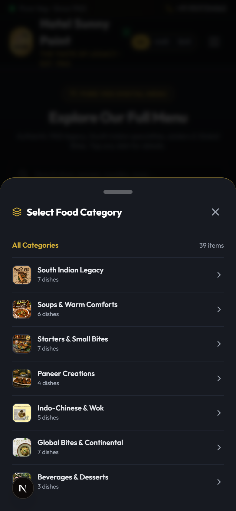
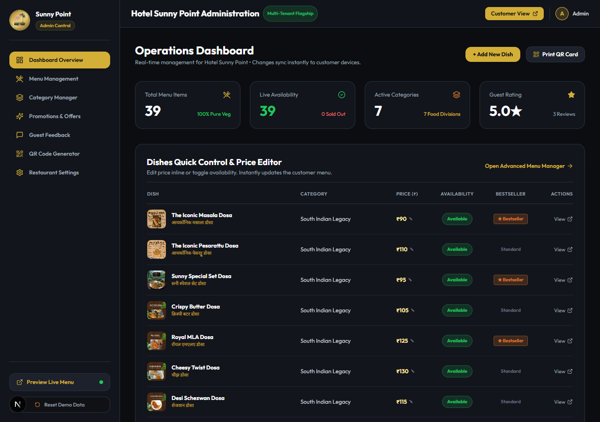
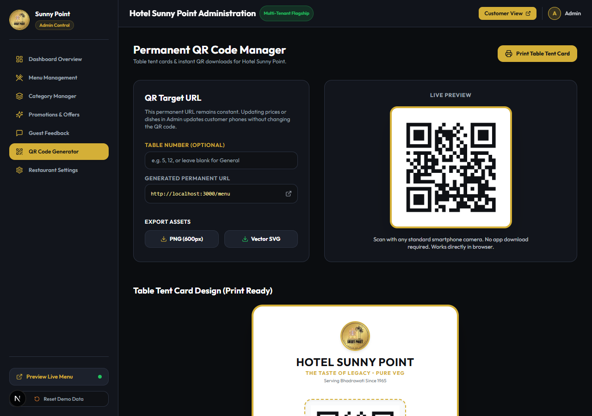

<div align="center">
  

  # Hotel Sunny Point — Pure Veg, Bhadrawati
  ### *The Taste of Legacy — Serving Bhadrawati Since 1965*

  <p align="center">
    <b>Main Road, Near Old Bus Stand, Bhadrawati, Chandrapur District, Maharashtra 442902</b><br />
    <i>South Indian Dosa Traditions Since 1995 • 100% Pure Vegetarian Multi-Cuisine Dining</i>
  </p>

  <p align="center">
    <a href="https://rushikesh5102.github.io/Hotel-Sunny-Point/"></a>
    <a href="https://github.com/Rushikesh5102/Hotel-Sunny-Point"></a>
  </p>

  <p align="center">
    <a href="https://nextjs.org/"></a>
    <a href="https://www.typescriptlang.org/"></a>
    <a href="https://tailwindcss.com/"></a>
    <a href="https://react.dev/"></a>
    <a href="https://supabase.com/"></a>
    
    
    
    
  </p>

  <p align="center">
    <b>Quick Links:</b><br />
    <a href="https://rushikesh5102.github.io/Hotel-Sunny-Point/">🌐 <b>GitHub Pages Live Preview</b></a> • 
    <a href="https://github.com/Rushikesh5102/Hotel-Sunny-Point">🐙 <b>GitHub Repository</b></a> • 
    <a href="#-visual-previews--platform-gallery">📸 <b>Visual Gallery</b></a> • 
    <a href="#7-phase-14-documentation-index">📖 <b>Documentation Suite</b></a>
  </p>
</div>

---

## 📸 Visual Previews & Platform Gallery

Here is a visual overview of the application verified under external browser automation:

### 1. Desktop Experience & Heritage Showcase
| Desktop Hero Banner & Bilingual Navigation | 1965 Vintage Gazette & 1995 Iconic Dosa |
| :---: | :---: |
|  |  |
| *Atmospheric cinematic hero with warm gold accents* | *Authentic vintage 1965 newsprint and 1995 Dosa feature* |

### 2. Tri-Lingual Menu & Dish Inspection Modal
| Tri-Lingual Menu (Hindi / Devanagari) | Dish Details Modal & Pairings |
| :---: | :---: |
|  |  |
| *Instant switch between English, मराठी, and हिन्दी* | *Heritage notes, spice meter, ingredients, and beverage pairings* |

### 3. Mobile-First Viewport (iPhone 14 Viewport — 390x844)
| High-Density Compact List View | Slide-Up Category Bottom Sheet |
| :---: | :---: |
|  |  |
| *Sticky 5-tab bottom dock & high-density food cards* | *Thumb-friendly floating Category Action Button (FAB)* |

### 4. Operations Admin Portal & Permanent QR Studio
| Operations Dashboard & Stock Controls | Permanent QR Code & Printable Table Tent |
| :---: | :---: |
|  |  |
| *Real-time KPI metric counters and instant availability switches* | *Permanent target `/menu` with table parameter & print CSS* |

---

## 1. Executive Overview

**Hotel Sunny Point** is an iconic 3-story pure vegetarian culinary institution located at Main Road, Near Old Bus Stand, Bhadrawati, Chandrapur District, Maharashtra. Founded in 1965 and pioneering authentic South Indian dosa traditions in Bhadrawati since 1995, the restaurant serves thousands of local families, commuters, and travelers daily.

This application is a **custom-engineered digital menu and restaurant operations platform** designed specifically for Hotel Sunny Point. It combines a mobile-first, cartless digital dining experience with an administrative dashboard and a multi-tenant Supabase relational backend architecture.

- **GitHub Repository**: [https://github.com/Rushikesh5102/Hotel-Sunny-Point](https://github.com/Rushikesh5102/Hotel-Sunny-Point)
- **Live GitHub Pages Preview**: [https://rushikesh5102.github.io/Hotel-Sunny-Point/](https://rushikesh5102.github.io/Hotel-Sunny-Point/)

---

## 2. Core Features & Architecture

### 2.1 Customer-Facing Digital Menu
- **Tri-Lingual Engine (EN / मराठी / हिन्दी)**: Instant client-side switching between English, Marathi, and Hindi Devanagari typography with zero page reload.
- **39 Seeded Culinary Items across 7 Categories**:
  1. *South Indian Legacy* (Dosas since 1995, Pesarattu, Set Dosa)
  2. *Soups & Warm Comforts* (All verified under ₹120)
  3. *Starters & Small Bites* (Dragon rolls, veg lollipops, baked nachos)
  4. *Paneer Creations* (Butterfly paneer, paneer satay, sizzler platters)
  5. *Indo-Chinese & Wok* (Triple schezwan rice, hakka noodles)
  6. *Global Bites & Continental* (Aglio e Olio, stroganoff, baked gratins)
  7. *Beverages & Desserts* (Signature fried ice cream, hot chocolate, filter coffee)
- **Real-Time Instant Search**: Sub-10ms client-side search across dish titles, Marathi names, tags, and ingredients.
- **Interactive Dish Details Modal**: Displays 1995 heritage backstory, verified price vs demo tariff status, spice meter, ingredients, allergen warnings, beverage pairing suggestions, and native Web Share links.
- **Dual View Modes**: Switch between rich visual card grid and high-density compact mobile list view for fast ordering.

### 2.2 Mobile-First User Experience
- **Sticky Bottom Navigation Dock**: 5 thumb-friendly tabs (`Home`, `Menu`, `Offers`, `Story`, `Admin`) optimized for modern smartphone viewports.
- **Floating Category FAB**: Floating action button opening a slide-up Category Bottom Sheet drawer on mobile.
- **Zero Horizontal Overflow**: Tested and verified across 320px, 375px (iPhone 14), 430px, and 768px viewports.

### 2.3 Operations & Administrative Dashboard (`/admin`)
- **Operations Overview**: Real-time KPI metric counters (Total Dishes, Active Stock, Categories, Rating).
- **Instant Stock Toggle**: One-click availability switch that immediately marks dishes as *"Currently Unavailable"* with visual badges.
- **Inline Price Editor**: Modify menu prices with reactive synchronization across browser tabs via an event bus.
- **Menu Management (`/admin/menu`)**: Full CRUD modal editor with image thumbnail selection, dietary flags, and pairing recommendations.
- **Category Manager (`/admin/categories`)**: Add, edit, reorder, or delete food categories.
- **Promotions & Offers (`/admin/promotions`)**: Schedule seasonal campaigns (e.g. *Monsoon Affairs*), discount percentages, and coupon codes.
- **Guest Feedback Portal (`/admin/feedback`)**: Review 5-criteria customer ratings and manage feedback lifecycle.
- **Restaurant Profile (`/admin/settings`)**: Manage restaurant operating hours, phone lines, FSSAI registration, and brand colors.

### 2.4 Permanent QR Code Studio & Table Tent Card (`/admin/qr`)
- **Permanent Dynamic QR Code**: Generates QR codes pointing permanently to the digital menu (`/menu`), with dynamic table parameterization (`?table=4`).
- **High-Resolution Export**: Download 600px PNG or scalable SVG.
- **Printable Table Tent Card**: Dedicated `@media print` stylesheet isolating a luxury gold table tent card ready for professional printing.

### 2.5 Multi-Tenant Supabase Architecture
- **Tenant Isolation**: Every relational entity references `restaurant_id` with `ON DELETE CASCADE`.
- **Row Level Security (RLS)**: Public read access for active menus; guest privacy protection for customer feedback; authenticated RBAC write access for tenant administrators.
- **Role-Based Access Control**: Granular roles (`super_admin`, `store_manager`, `kitchen_staff`, `auditor`).
- **Reversible Migrations**: Staged in `supabase/migrations/` with a clean rollback script.

---

## 3. Directory Structure

```
Hotel Sunny Point/
├── README.md                       # Master documentation & visual showcase
├── ASSET_CATALOG.md                # 80-file raw media catalog (photos, videos, metadata)
├── CONTENT_RESEARCH.md             # Extracted brand story, history & culinary notes
├── MISSING_INFORMATION.md          # Client clarification questions & rate inquiries
├── DESIGN_SYSTEM.md                # Color tokens, typography, borders, UI components
├── FRONTEND_ARCHITECTURE.md        # Technical component design & state management
├── FRONTEND_TEST_REPORT.md         # Route testing & native Chrome automation report
├── FRONTEND_AUDIT.md               # Technical component tree & bundle footprint audit
├── SECURITY_AUDIT.md               # Threat modeling & Supabase SSR Auth blueprint
├── DATA_VERIFICATION_REPORT.md     # 39-dish provenance & price governance registry
├── SUPABASE_IMPLEMENTATION_PLAN.md # Initial multi-tenant database specification
├── MIGRATION_PLAN.md               # Zero-downtime transition & rollback roadmap
├── SUPABASE_FINAL_SCHEMA.md        # Finalized ERD, 9 tables DDL & constraints
├── RLS_SECURITY_MATRIX.md          # Access control matrix & attack mitigations
├── AUTHENTICATION_IMPLEMENTATION.md# @supabase/ssr Next.js middleware specification
├── DATABASE_MIGRATION_REPORT.md    # Transformation rules & seed data audit
├── BACKEND_TEST_REPORT.md          # 12-suite backend security test specification
├── PHASE_4_COMPLETION_REPORT.md    # Phase 4 readiness & approval gate
├── public/
│   ├── assets/
│   │   ├── brand/                  # Logo, building facade, heritage posters
│   │   └── dishes/                 # 39 optimized food photographs
│   └── screenshots/                # Native Chrome verification screenshots
├── src/
│   ├── app/                        # Next.js 15 App Router
│   │   ├── page.tsx                # Homepage (Hero, Gazette, 1995 Dosa)
│   │   ├── menu/page.tsx           # Full digital menu & category filters
│   │   ├── dish/[slug]/page.tsx    # Shareable dish detail route
│   │   ├── about/page.tsx          # Heritage story & 1965 timeline
│   │   ├── offers/page.tsx         # Seasonal vouchers & promotions
│   │   ├── feedback/page.tsx       # 5-criteria guest feedback form
│   │   ├── contact/page.tsx        # Hours, directions & contact lines
│   │   └── admin/                  # Operations Admin Portal (7 Sub-routes)
│   ├── components/                 # 11 Reusable React Components
│   │   ├── home/                   # Homepage sectional blocks
│   │   └── ui/                     # Cards, modals, header, footer, bottom bar
│   ├── context/                    # Global RestaurantContext (State & Language)
│   ├── data/                       # Initial data & Repository Layer
│   └── types/                      # Complete TypeScript domain interfaces
└── supabase/
    └── migrations/                 # Version-controlled PostgreSQL migrations
        ├── 20261104000001_initial_schema.sql
        ├── 20261104000002_rls_policies.sql
        ├── 20261104000003_seed_data.sql
        └── 20261104000004_rollback.sql
```

---

## 4. Technology Stack

| Layer | Technologies Used |
|:---|:---|
| **Framework** | [Next.js 15.1.4](https://nextjs.org/) (App Router, Server & Client Components) |
| **Language** | [TypeScript 5.7.2](https://www.typescriptlang.org/) (Strict Mode) |
| **Styling** | [Tailwind CSS 3.4.16](https://tailwindcss.com/) & Vanilla CSS Tokens |
| **Icons & Micro-animations** | [Lucide React 0.469.0](https://lucide.dev/) & [Framer Motion 11.15.0](https://www.framer.com/motion/) |
| **QR Code Engine** | [node-qrcode 1.5.4](https://github.com/soldair/node-qrcode) (Canvas PNG & SVG) |
| **Image Optimization** | [Sharp 0.35.5](https://sharp.pixelplumbing.com/) (Next.js Image Optimizer) |
| **Database & Auth** | [Supabase](https://supabase.com/) (PostgreSQL 15+, Row Level Security, `@supabase/ssr`) |

---

## 5. Getting Started & Local Development

### 5.1 Prerequisites
- **Node.js**: `v18.18.0` or higher (Node 20+ recommended)
- **Package Manager**: `npm`

### 5.2 Installation
```bash
git clone https://github.com/Rushikesh5102/Hotel-Sunny-Point.git
cd Hotel-Sunny-Point
npm install
```

### 5.3 Running the Development Server
```bash
npm run dev
```
Open [http://localhost:3000](http://localhost:3000) in your browser.

- Customer Homepage: `http://localhost:3000`
- Full Digital Menu: `http://localhost:3000/menu`
- Admin Dashboard: `http://localhost:3000/admin`
- QR Code Studio: `http://localhost:3000/admin/qr`

### 5.4 Building for Production
```bash
npm run build
npm run start
```

### 5.5 Quality Audits
```bash
# Run ESLint validation
npm run lint

# Run TypeScript strict type-checking
npx tsc --noEmit
```

---

## 6. Restaurant Client Details

- **Business Name**: Hotel Sunny Point — Pure Veg
- **Brand Tagline**: "The Taste of Legacy — Pure Veg"
- **Heritage**: Serving Bhadrawati Since 1965 | South Indian Dosa Pioneer Since 1995
- **Location**: Main Road, Near Old Bus Stand, Bhadrawati, Chandrapur District, Maharashtra 442902
- **Operating Hours**: Monday – Sunday, 7:30 AM – 10:30 PM (All 7 Days)
- **Primary Phone**: `+91 9511724562`
- **Secondary Phone**: `7517469858`
- **Email**: `contact@hotelsunnypoint.com`
- **FSSAI License Registration**: `0000907350`
- **Instagram**: [@hotelsunnypoint](https://www.instagram.com/hotelsunnypoint/)
- **Live Preview**: [https://rushikesh5102.github.io/Hotel-Sunny-Point/](https://rushikesh5102.github.io/Hotel-Sunny-Point/)
- **GitHub Repository**: [https://github.com/Rushikesh5102/Hotel-Sunny-Point](https://github.com/Rushikesh5102/Hotel-Sunny-Point)

---

## 7. Phase 1–4 Documentation Index

| Phase / Focus Area | Document File | Description |
|:---|:---|:---|
| **Asset Audit** | [ASSET_CATALOG.md](ASSET_CATALOG.md) | Audit of all 80 original files in `Hotel Sunny Point Data/` |
| **Content Research** | [CONTENT_RESEARCH.md](CONTENT_RESEARCH.md) | Historical timeline, brand voice, slogans & regional Marathi copy |
| **Missing Info** | [MISSING_INFORMATION.md](MISSING_INFORMATION.md) | Client inquiries and physical menu tariff verifications |
| **Design System** | [DESIGN_SYSTEM.md](DESIGN_SYSTEM.md) | Color palettes, typography hierarchy, UI tokens & responsive grid |
| **Frontend Architecture** | [FRONTEND_ARCHITECTURE.md](FRONTEND_ARCHITECTURE.md) | React App Router structure, component hierarchy & repository |
| **Frontend QA** | [FRONTEND_TEST_REPORT.md](FRONTEND_TEST_REPORT.md) | Native Chrome automation report & 8 high-resolution screenshots |
| **Frontend Audit** | [FRONTEND_AUDIT.md](FRONTEND_AUDIT.md) | Component tree tracing, bundle size (103 kB) & dependency audit |
| **Security Audit** | [SECURITY_AUDIT.md](SECURITY_AUDIT.md) | Vulnerability analysis & Supabase SSR Auth migration blueprint |
| **Data Verification** | [DATA_VERIFICATION_REPORT.md](DATA_VERIFICATION_REPORT.md) | Registry of all 39 dishes, photo mappings & price status tags |
| **Supabase Architecture** | [SUPABASE_FINAL_SCHEMA.md](SUPABASE_FINAL_SCHEMA.md) | Final ERD, 9 tables DDL, foreign keys, indexes & storage buckets |
| **Row Level Security** | [RLS_SECURITY_MATRIX.md](RLS_SECURITY_MATRIX.md) | Access control matrix, tenant isolation & attack mitigations |
| **Authentication Spec** | [AUTHENTICATION_IMPLEMENTATION.md](AUTHENTICATION_IMPLEMENTATION.md) | Next.js 15 Middleware session sync & role verification |
| **Data Migration Spec** | [DATABASE_MIGRATION_REPORT.md](DATABASE_MIGRATION_REPORT.md) | Multi-lingual JSONB mapping & seed execution manifest |
| **Backend Testing** | [BACKEND_TEST_REPORT.md](BACKEND_TEST_REPORT.md) | 12 security test suites & pre-flight compilation results |
| **Phase 4 Completion** | [PHASE_4_COMPLETION_REPORT.md](PHASE_4_COMPLETION_REPORT.md) | Phase 4 readiness report & environment configuration |
| **Theme System Architecture** | [THEME_SYSTEM.md](THEME_SYSTEM.md) | Dual theme tokens, CSS custom properties, zero-flash script & switcher spec |
| **Theme Implementation Audit** | [THEME_IMPLEMENTATION_REPORT.md](THEME_IMPLEMENTATION_REPORT.md) | 17-route customer and admin audit, component refactorings & state preservation |
| **Theme Visual QA** | [THEME_VISUAL_QA_REPORT.md](THEME_VISUAL_QA_REPORT.md) | WCAG contrast audit, 6-breakpoint responsive tests, and zero-defect sign-off |

---

## 8. License & Credits

Developed for **Hotel Sunny Point**, Bhadrawati, Maharashtra.  
All photographic assets and brand logos are copyrighted by Hotel Sunny Point.
