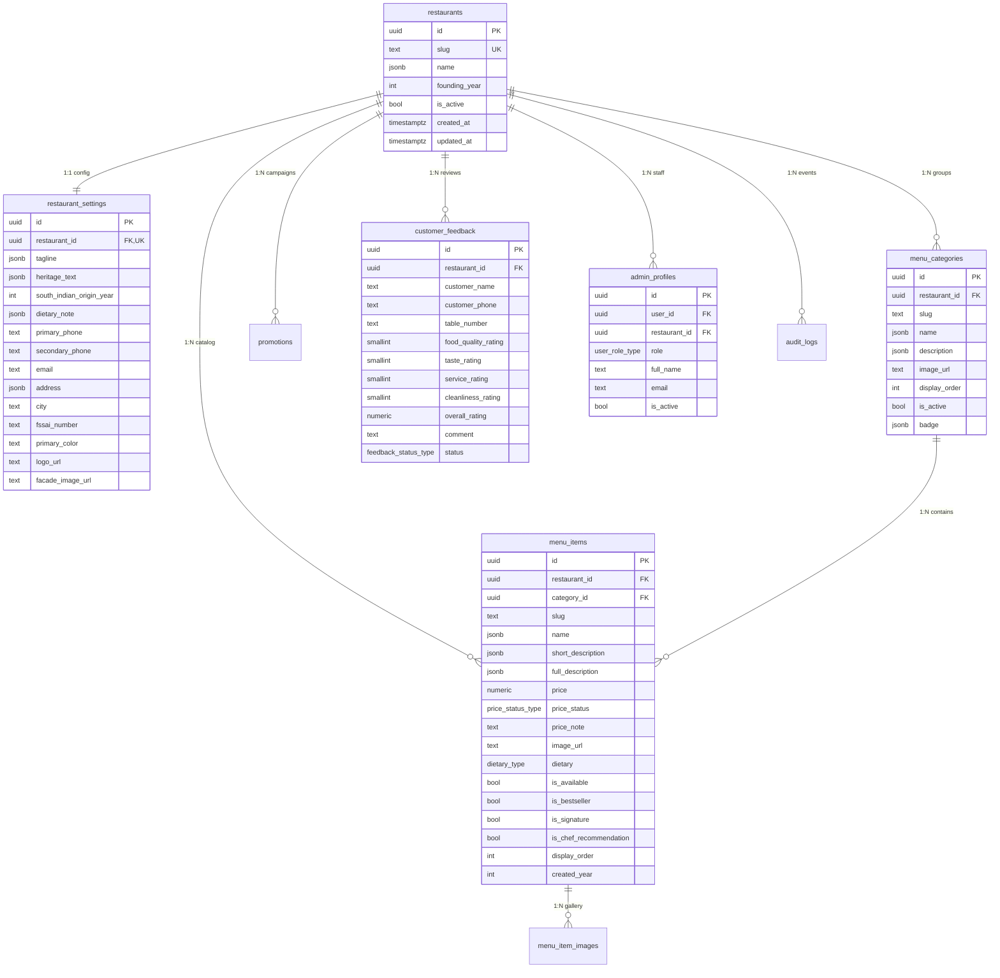

# HOTEL SUNNY POINT — SUPABASE FINAL RELATIONAL SCHEMA
*Multi-Tenant Data Architecture, Entity Relationships, Constraints & Indexing Strategy*

---

## 1. Architecture Overview & ERD Diagram

The backend architecture is modeled as a high-performance, multi-tenant relational system in PostgreSQL hosted via Supabase. Every entity is partitioned by `restaurant_id` to guarantee tenant isolation, allowing Hotel Sunny Point to serve as the flagship property while seamlessly supporting commercial multi-restaurant SaaS expansion.

---

## 2. Table Specifications & Constraints

### 2.1 `restaurants` (Tenant Root)
- **Primary Key**: `id UUID DEFAULT gen_random_uuid()`
- **Constraints**:
  - `slug TEXT UNIQUE NOT NULL`
  - `founding_year INTEGER NOT NULL DEFAULT 1965`
  - `is_active BOOLEAN NOT NULL DEFAULT true`
- **Purpose**: Master entity for multi-tenancy. All children reference this ID with `ON DELETE CASCADE`.

### 2.2 `restaurant_settings` (Brand & Operating Metadata)
- **Primary Key**: `id UUID DEFAULT gen_random_uuid()`
- **Foreign Key**: `restaurant_id UUID NOT NULL REFERENCES restaurants(id) ON DELETE CASCADE`
- **Constraint**: `UNIQUE (restaurant_id)` (Strict 1:1 relationship)
- **Fields**:
  - `tagline JSONB`: Multi-lingual brand tagline (`{"en": "...", "mr": "...", "hi": "..."}`)
  - `heritage_text JSONB`: Multi-lingual backstory (1965 founding, 1995 South Indian introduction)
  - `primary_phone TEXT NOT NULL`, `secondary_phone TEXT`
  - `fssai_number TEXT NOT NULL DEFAULT '0000907350'`
  - `primary_color TEXT NOT NULL DEFAULT '#D4AF37'`, `accent_color TEXT NOT NULL DEFAULT '#E07A2B'`
  - `logo_url TEXT NOT NULL`, `facade_image_url TEXT NOT NULL`

### 2.3 `menu_categories` (Catalog Groupings)
- **Primary Key**: `id UUID DEFAULT gen_random_uuid()`
- **Foreign Key**: `restaurant_id UUID NOT NULL REFERENCES restaurants(id) ON DELETE CASCADE`
- **Constraint**: `UNIQUE (restaurant_id, slug)` (Slug uniqueness scoped per tenant)
- **Fields**:
  - `slug TEXT NOT NULL` (`south-indian`, `soups`, `starters`, `paneer-specialities`, `chinese`, `global-bites`, `desserts-beverages`)
  - `name JSONB NOT NULL`, `description JSONB NOT NULL`, `badge JSONB`
  - `display_order INTEGER NOT NULL DEFAULT 0`
  - `is_active BOOLEAN NOT NULL DEFAULT true`
- **Indexes**: `(restaurant_id)`, `(restaurant_id, display_order)`

### 2.4 `menu_items` (Dishes)
- **Primary Key**: `id UUID DEFAULT gen_random_uuid()`
- **Foreign Keys**:
  - `restaurant_id UUID NOT NULL REFERENCES restaurants(id) ON DELETE CASCADE`
  - `category_id UUID NOT NULL REFERENCES menu_categories(id) ON DELETE CASCADE`
- **Constraint**: `UNIQUE (restaurant_id, slug)`
- **Check Constraints**:
  - `CHECK (price >= 0)`
  - `CHECK (spiciness_level IN (1, 2, 3))`
  - `CHECK (preparation_time_minutes > 0)`
- **Enums**:
  - `price_status price_status_type DEFAULT 'provisional_sample'` (`verified` vs `provisional_sample`)
  - `dietary dietary_type DEFAULT 'pure_veg'` (`pure_veg`, `vegan`, `jain_available`)
- **Metadata Fields**: `ingredients JSONB`, `allergens JSONB`, `pairing_suggestions JSONB`
- **Indexes**: `(restaurant_id)`, `(restaurant_id, category_id)`, `(restaurant_id, display_order)`, `(restaurant_id, is_available)`

### 2.5 `menu_item_images` (Alternate & Gallery Photos)
- **Primary Key**: `id UUID DEFAULT gen_random_uuid()`
- **Foreign Keys**:
  - `menu_item_id UUID NOT NULL REFERENCES menu_items(id) ON DELETE CASCADE`
  - `restaurant_id UUID NOT NULL REFERENCES restaurants(id) ON DELETE CASCADE`
- **Fields**: `storage_path TEXT NOT NULL`, `alt_text TEXT`, `is_primary BOOLEAN DEFAULT false`, `display_order INTEGER DEFAULT 0`

### 2.6 `promotions` (Monsoon Affairs & Seasonal Offers)
- **Primary Key**: `id UUID DEFAULT gen_random_uuid()`
- **Foreign Key**: `restaurant_id UUID NOT NULL REFERENCES restaurants(id) ON DELETE CASCADE`
- **Check Constraint**: `CHECK (end_date >= start_date)`
- **Fields**: `title JSONB`, `subtitle JSONB`, `description JSONB`, `badge_text TEXT`, `banner_image_url TEXT`, `coupon_code TEXT`, `discount_description TEXT`, `is_active BOOLEAN`
- **Indexes**: `(restaurant_id, is_active, start_date, end_date)`

### 2.7 `customer_feedback` (Guest Ratings & Comments)
- **Primary Key**: `id UUID DEFAULT gen_random_uuid()`
- **Foreign Key**: `restaurant_id UUID NOT NULL REFERENCES restaurants(id) ON DELETE CASCADE`
- **Check Constraints**:
  - `food_quality_rating SMALLINT CHECK (food_quality_rating BETWEEN 1 AND 5)`
  - `taste_rating SMALLINT CHECK (taste_rating BETWEEN 1 AND 5)`
  - `service_rating SMALLINT CHECK (service_rating BETWEEN 1 AND 5)`
  - `cleanliness_rating SMALLINT CHECK (cleanliness_rating BETWEEN 1 AND 5)`
  - `overall_rating NUMERIC(3,2) CHECK (overall_rating BETWEEN 1.0 AND 5.0)`
- **Status Enum**: `status feedback_status_type DEFAULT 'new'` (`new`, `reviewed`, `archived`)
- **Indexes**: `(restaurant_id, created_at DESC)`, `(restaurant_id, status)`

### 2.8 `admin_profiles` (Role-Based Access Control)
- **Primary Key**: `id UUID DEFAULT gen_random_uuid()`
- **Foreign Keys**:
  - `user_id UUID NOT NULL REFERENCES auth.users(id) ON DELETE CASCADE`
  - `restaurant_id UUID NOT NULL REFERENCES restaurants(id) ON DELETE CASCADE`
- **Constraint**: `UNIQUE (user_id, restaurant_id)`
- **Role Enum**: `user_role_type DEFAULT 'store_manager'` (`super_admin`, `store_manager`, `kitchen_staff`, `auditor`)
- **Indexes**: `(user_id)`, `(restaurant_id)`

### 2.9 `audit_logs` (Immutable Action Log)
- **Primary Key**: `id UUID DEFAULT gen_random_uuid()`
- **Foreign Keys**:
  - `restaurant_id UUID NOT NULL REFERENCES restaurants(id) ON DELETE CASCADE`
  - `admin_id UUID REFERENCES admin_profiles(id) ON DELETE SET NULL`
- **Fields**: `entity_name TEXT`, `entity_id TEXT`, `action TEXT`, `before_state JSONB`, `after_state JSONB`, `ip_address INET`, `created_at TIMESTAMPTZ DEFAULT now()`
- **Indexes**: `(restaurant_id, created_at DESC)`, `(restaurant_id, entity_name, entity_id)`

---

## 3. Storage Bucket Design

| Bucket Identifier | Visibility | Target Contents | Access Policy |
|:---|:---:|:---|:---|
| **`restaurant-public`** | **Public** | Dish photography (`/dishes/*`), Brand seals (`/brand/*`), Promotion banners (`/promotions/*`) | Anyone can read (`GET`). Authenticated tenant admins can `INSERT`/`UPDATE`/`DELETE`. |
| **`restaurant-private`** | **Private** | Audit log archives, guest feedback CSV exports, FSSAI regulatory filings | Authenticated admins only via Supabase signed URLs (TTL 60s). |

---

## 4. Version-Controlled Migration Manifest

The complete DDL is version-controlled in the workspace:
1. [20261104000001_initial_schema.sql](file:///c:/Users/Rushi/Desktop/Hotel%20Sunny%20Point/supabase/migrations/20261104000001_initial_schema.sql) — Core tables, enums, triggers, and indexes.
2. [20261104000002_rls_policies.sql](file:///c:/Users/Rushi/Desktop/Hotel%20Sunny%20Point/supabase/migrations/20261104000002_rls_policies.sql) — Tenant isolation & RBAC security policies.
3. [20261104000003_seed_data.sql](file:///c:/Users/Rushi/Desktop/Hotel%20Sunny%20Point/supabase/migrations/20261104000003_seed_data.sql) — Seed data (1 restaurant, settings, 7 categories, 39 dishes).
4. [20261104000004_rollback.sql](file:///c:/Users/Rushi/Desktop/Hotel%20Sunny%20Point/supabase/migrations/20261104000004_rollback.sql) — Complete, safe reversible teardown script.
